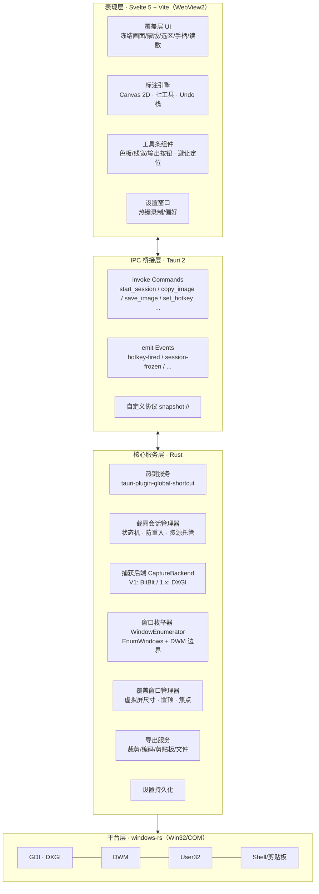
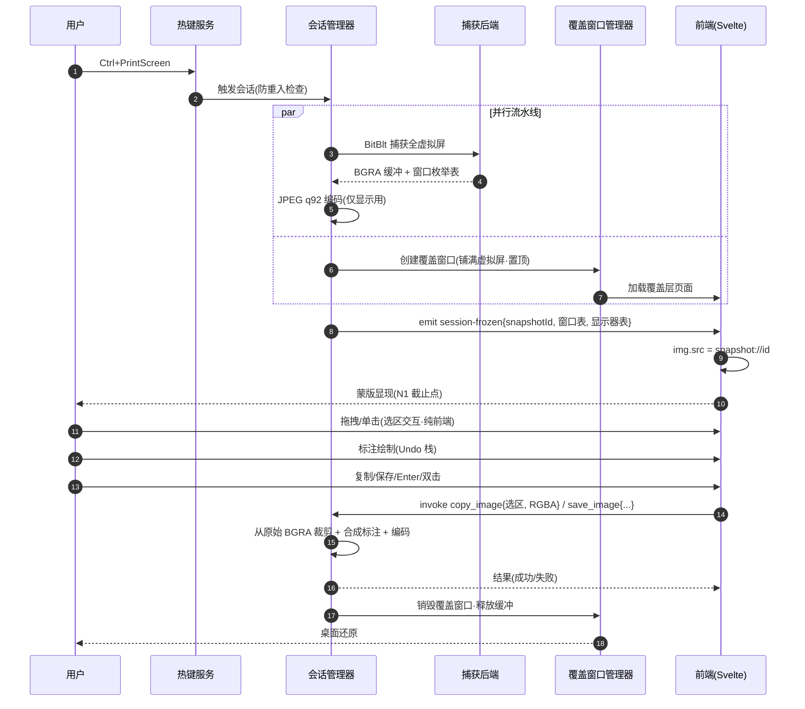
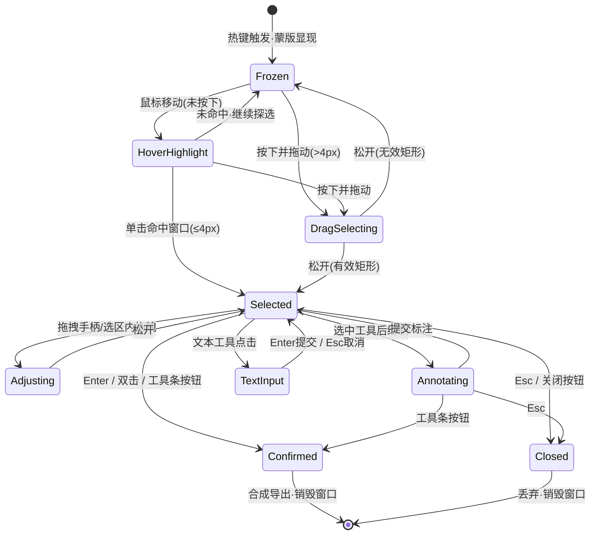

# 《极速截图》桌面应用开发计划

| 项目 | 内容 |
| --- | --- |
| 项目代号 | 极速截图（JetSnap） |
| 文档版本 | v1.0 |
| 编写日期 | 2026-10-12 |
| 目标平台 | Windows 10 21H2 及以上 / Windows 11 |
| 拟定技术栈 | Rust + Tauri 2 + Svelte 5 + Vite（可行性论证见第 3 章） |
| 开发模式 | 单人全栈 · 标准节奏 · 8~10 周 |
| 文档性质 | 开发计划（含需求规格、选型分析、架构设计、里程碑排期、风险管理、测试验收） |

## 目录

1. 项目概述
2. 需求规格说明
3. 技术选型与可行性分析
4. 系统架构设计
5. 核心模块详细设计
6. IPC 接口与数据结构
7. 开发里程碑与排期
8. 风险管理
9. 测试与验收
10. V2 路线图与附录

---

## 1. 项目概述

### 1.1 项目背景与目标

截图是 Windows 桌面环境下使用频率极高的基础操作，QQ 桌面版的屏幕截图功能历经十余年打磨，其「热键触发、冻结屏幕、智能选区、就地标注、一键取走」的交互范式已被亿级用户验证，成为事实上的体验基准。然而以 QQ 为代表的方案强绑定于 IM 客户端本身，独立、轻量、可自定义的同类工具（如 Snipaste、ShareX）在快捷键自由度、资源占用、安装体积等方面各有取舍，仍有明确的差异化空间。

本项目旨在开发一款名为「极速截图」（代号 JetSnap）的独立 Windows 桌面截图程序，完整复刻 QQ 截图的核心交互范式，并在此基础上做到三点 QQ 未尽之功：**完全可自定义的全局快捷键**（默认 Ctrl+PrintScreen，不与系统 PrintScreen 单键冲突）、**严格量化的极速体验**（热键到蒙版可见 ≤300ms）、**现代技术栈带来的轻量化**（安装包 ≤10MB、空闲内存 ≤60MB）。

本项目的成功标准是可度量而非体感的：其一，第 2.6 节列出的全部性能指标在指定硬件基准（见 9.3 节）下达标；其二，第 9.2 节的功能验收清单逐项通过；其三，第 9.4 节的 DPI/多显示器兼容矩阵全绿。三者缺一，不得发布 1.0。

### 1.2 产品定位与核心体验

极速截图定位为**常驻型系统工具**，而非大而全的效率套件。它的产品哲学是：用户在任意时刻按下快捷键，屏幕即刻「凝固」，随后的十秒内完成选择、标注、取走，全程不需要思考工具本身的存在。这一哲学决定了三条设计红线：任何环节的可见延迟都视为缺陷；任何影响专注的视觉噪音（弹窗、动画、提示音）都默认禁止；空闲状态对系统的打扰（CPU、内存、磁盘）必须趋近于零。

核心体验闭环为五个动词：**按（热键冻结）→ 选（拖拽/智能识别）→ 调（四角手柄精修）→ 标（七种工具就地批注）→ 走（复制/保存后立刻还原桌面）**。整个闭环在熟练用户手中应可在 5 秒内完成，且每一步都有明确的视觉反馈（蒙版亮度差、选区边框、尺寸读数、工具条就近出现）。

### 1.3 范围边界声明

**V1 严格实现以下用户需求，不多做、不少做**：自定义截图快捷键（默认 Ctrl+PrintScreen）；黑色半透明蒙版预览界面；拖拽矩形选区；单击智能识别鼠标所在窗口为选区（选区内蒙版 100% 全透明）；四角拖拽手柄调整选区；选区底部截图工具条（含全屏选区时工具条内置于选区底部内侧的可见性规则）；矩形、椭圆、箭头、画笔、马赛克、文本框、带数字标号文本框共七种标注工具；Undo 撤销；8×2 共 16 色预设色板 + 自定义颜色；5 档预设线宽 + 自定义线宽；复制选区到剪贴板；保存图片到文件。

**明确不在 V1 范围**（详见第 10 章路线图）：贴图（桌面便签）、滚动长截图、取色器/UIA 元素级识别、OCR、GIF/视频录制、多语言、自动更新。范围外需求一律不占用 V1 排期，避免功能蔓延拖垮核心体验的打磨时间。

### 1.4 术语表

| 术语 | 定义 |
| --- | --- |
| 虚拟屏幕（Virtual Screen） | Windows 中所有显示器的联合矩形区域，坐标系以主显示器左上角为原点，物理像素为单位 |
| 物理像素 / 逻辑像素 | 物理像素是屏幕真实像元；逻辑像素 = 物理像素 ÷ DPI 缩放系数。本计划 Rust 层一律使用物理像素，WebView 层一律使用逻辑像素，转换只发生在一处（见 5.2.1） |
| 冻结（Freeze） | 热键触发的瞬间完成全屏位图捕获，之后覆盖窗口展示该静态位图，桌面真实变化不再可见，等效于「时间停止」 |
| 蒙版（Mask） | 覆盖在冻结画面上的黑色半透明遮罩，选区处挖「洞」实现 100% 透明显亮 |
| 选区（Selection） | 用户当前划定并将被导出的矩形区域 |
| 命中测试（Hit-test） | 判定某个坐标点落在哪个窗口矩形内的算法，用于智能窗口识别 |
| DWM | Desktop Window Manager，Windows 视窗合成器，其 `DWMWA_EXTENDED_FRAME_BOUNDS` 可取得去除阴影后的真实窗口边界 |
| WebView2 | Windows 上的 Edge 内核 WebView 运行时，Tauri 在 Windows 的 UI 载体 |
| POC | Proof of Concept，开发前的小规模技术验证 |

---

## 2. 需求规格说明

### 2.1 功能需求总览

功能需求编号（FR）如下表，优先级定义：P0 = 缺失即阻塞发布；P1 = 应随 1.0 交付；P2 = 可延至 1.x 补丁。每条 FR 均在第 9.2 节验收清单中有对应验收项，保证「需求—实现—验收」三方追溯。

| 编号 | 功能 | 优先级 | 需求描述 |
| --- | --- | --- | --- |
| FR-01 | 自定义快捷键 | P0 | 全局热键可触发截图，默认 Ctrl+PrintScreen；用户可在设置界面录入新组合并即时生效；注册失败（冲突）时给出明确提示 |
| FR-02 | 冻结与蒙版 | P0 | 热键触发后立即冻结屏幕：覆盖窗口全屏显示捕获位图，其上叠加黑色半透明蒙版（50% 不透明度） |
| FR-03 | 拖拽选区 | P0 | 在蒙版上按下并拖拽鼠标画出矩形选区，选区内蒙版挖洞 100% 透明显亮，实时显示尺寸读数 |
| FR-04 | 智能窗口识别 | P0 | 仅点击（无拖拽）时，自动将鼠标所在窗口的矩形作为选区标出，蒙版对该区域同样 100% 透明 |
| FR-05 | 四角手柄 | P0 | 选区四角显示拖拽手柄，拖拽可调整选区大小 |
| FR-06 | 移动选区 | P1 | 在选区内部按下拖拽可整体移动选区 |
| FR-07 | 工具条定位与避让 | P0 | 工具条默认出现在选区正下方居中；空间不足时翻转到上方；选区为全屏（或下方与上方均无空间）时置于选区底部内侧，确保可见 |
| FR-08 | 矩形工具 | P0 | 拖拽绘制矩形边框，颜色/线宽可设 |
| FR-09 | 椭圆工具 | P0 | 拖拽绘制椭圆边框，以拖拽矩形为外接矩形 |
| FR-10 | 箭头工具 | P0 | 拖拽绘制带箭头的直线，箭头指向松开鼠标方向 |
| FR-11 | 画笔工具 | P0 | 自由手绘线条，采集鼠标轨迹绘制平滑折线 |
| FR-12 | 马赛克工具 | P0 | 涂抹区域呈现像素化（马赛克）效果，涂抹路径即时生效 |
| FR-13 | 文本框工具 | P0 | 点击选区放置文本输入框，输入文字以所选颜色渲染，Enter 确认、Esc 取消输入 |
| FR-14 | 数字标号工具 | P0 | 点击放置带自增数字标号的圆形标记（1、2、3……），用于步骤标注 |
| FR-15 | Undo | P0 | 撤销最近一次标注，可连续撤销至无标注状态；不影响选区本身 |
| FR-16 | 色板 | P0 | 8 列 × 2 行共 16 个预设色块 + 自定义颜色入口，对当前工具生效 |
| FR-17 | 线宽 | P0 | 5 档预设线宽 + 自定义线宽（滑杆），对当前工具生效 |
| FR-18 | 复制到剪贴板 | P0 | 将选区（含标注）以位图形式写入系统剪贴板，兼容主流应用的粘贴 |
| FR-19 | 保存图片 | P0 | 弹出保存对话框，将选区（含标注）保存为 PNG/JPEG 文件 |
| FR-20 | 尺寸读数 | P2 | 拖拽选区/手柄时在选区旁显示 `宽×高`（物理像素） |
| FR-21 | 退出截图 | P0 | Esc 键或工具条关闭按钮退出截图会话，立即还原桌面；Enter 或双击选区内空白等效于「复制并退出」 |

### 2.2 截图主流程交互规范

主流程按时间轴分为八个步骤（S1~S8），每一步都有明确的进入条件、用户动作、系统反馈与异常分支。这八步是全应用的交互骨架，后续所有详细设计均服务于这条主干。

| 步骤 | 用户动作 | 系统行为 | 异常与边界 |
| --- | --- | --- | --- |
| S1 按下热键 | Ctrl+PrintScreen | 常驻进程捕获热键，立即（同帧）启动截图流水线 | 若上一次会话未结束，忽略重复触发（防重入） |
| S2 冻结捕获 | —（等待） | 后台完成全虚拟屏位图捕获（BitBlt），同时枚举可见顶层窗口并缓存 | 捕获失败（如安全桌面）时 toast 提示并终止会话 |
| S3 蒙版显现 | —（等待） | 覆盖窗口（无边框、置顶）铺满虚拟屏，展示冻结位图 + 50% 黑色蒙版；鼠标进入「探选」状态 | 覆盖窗口创建失败时降级为主屏单窗口并记录日志 |
| S4 划定选区 | 拖拽（FR-03）或单击（FR-04） | 拖拽画出矩形并实时显示尺寸；单击命中窗口则高亮并直接成为选区；未选中任何窗口的单击保持等待 | 位移 ≤4px 视为单击；命中测试失败则退化为 48×48 缺省选区 |
| S5 选区精修 | 拖拽四角手柄 / 拖拽选区内部 | 调整大小 / 移动位置；工具条按避让算法重新定位 | 选区最小 8×8 物理像素，不越出虚拟屏 |
| S6 就地标注 | 选择工具后在选区内绘制 | 矩形/椭圆/箭头/画笔/马赛克/文本/数字标号依次渲染在标注层；Undo 可回退 | 工具条未选中工具时选区仍可继续精修；Esc 退出整个会话 |
| S7 取走结果 | 点击工具条「复制/保存」/ Enter / 双击 | 将「选区位图 + 标注层」合成为最终图像，写入剪贴板或文件 | 复制/保存失败时保留会话并弹错，不让用户丢失标注 |
| S8 还原桌面 | —（自动） | 关闭覆盖窗口、释放会话内存，回到热键前的桌面状态 | — |

**冻结语义**是本应用最重要的交互契约：S3 之后用户看到的一切都是热键瞬间的静态画面。这意味着标注期间桌面发生的任何变化（视频播放、弹窗）都不影响最终输出；同时也意味着捕获必须在 S2 内完成——这是第 2.6 节性能指标中「热键→蒙版可见 ≤300ms」的直接来源。

### 2.3 选区交互规范

#### 2.3.1 蒙版层

蒙版为纯黑、50% 不透明度（`rgba(0,0,0,0.5)`）的整屏覆盖层，绘制于冻结位图之上、标注层之下。选区矩形以「挖洞」方式从蒙版中扣除，洞内完全透出冻结位图原亮度，实现需求所述的「选定区域 100% 全透明蒙版」。挖洞实现上使用 Canvas 的 `evenodd` 填充路径（外框整屏矩形 + 内框选区矩形反向）或四块矩形拼接，两者均可在拖拽中保持 ≥50fps 的重绘性能（详见 5.2.2）。选区边缘绘制 1 物理像素亮色（`#4A9EFF`）边框以强化边界感知，该边框仅用于预览、不进入最终导出图像。

#### 2.3.2 拖拽选区（FR-03）

用户在蒙版任意位置按下鼠标（不在已有选区内、不在手柄上），拖拽即从按下点为锚点动态生成矩形选区，松开鼠标时选区生效并触发工具条出现。拖拽全程显示尺寸读数（FR-20），格式 `1920×1080`，取物理像素值，跟随选区右下角偏移 8px，若超出虚拟屏则自动翻转至选区左上角。位移小于 4 物理像素的按下-松开不产生选区，转入 2.3.3 的单击判定。反向拖拽（从右下往左上）需正确归一化为左上-右下表示。

#### 2.3.3 智能窗口识别（FR-04）

**触发条件**：按下-松开的位移 ≤4 物理像素。**识别时机**：窗口列表在 S2 冻结瞬间由 Rust 侧同步枚举缓存（此时覆盖窗口尚未创建，枚举结果不受自身污染），前端只做纯内存命中测试。**命中算法**：按 z-order 自顶向下遍历缓存窗口，命中第一个边界包含点击点的可见窗口；若多个窗口嵌套包含同一点，取 z 序更高者；若点击点位于任务栏，命中任务栏矩形本身（与 QQ 行为一致）。

**悬停预高亮（P1）**：尚无选区且鼠标在蒙版上移动时，实时命中并将候选窗口以「亮边框 + 轻微提亮」预告，让用户在点击前即可预判识别结果——这是 QQ 截图体验不可或缺的一环，缺失会导致「点选窗口」功能形同盲盒。**边界修正**：窗口矩形统一使用 `DWMWA_EXTENDED_FRAME_BOUNDS`（去除 Win10/11 不可见阴影边框后的真实视觉边界），避免识别结果比肉眼所见大一圈。**窗口过滤**：枚举时剔除不可见窗口、最小化窗口、工具提示窗口、 cloaked 的 UWP 挂起窗口（`DWMWA_CLOAKED` 非零）以及本应用自身窗口。

#### 2.3.4 选区精修（FR-05 / FR-06）

选区四角各绘制一个 12×12 逻辑像素的手柄方块（视觉 8×8 + 4px 命中扩展），命中时分别显示 `nwse-resize` / `nesw-resize` 光标。拖拽手柄时对角点固定为锚点，实时归一化并夹紧到虚拟屏。在选区内部按下拖拽则整体平移选区（FR-06），同样夹紧不越界。选区最小尺寸 8×8 物理像素，达到最小值时继续拖拽不再缩小。精修过程中工具条持续按 2.3.5 的算法重新定位，保证工具条永远可见。

#### 2.3.5 工具条定位与避让算法（FR-07）

工具条尺寸记为 `TW×TH`（约 470×44 逻辑像素，随 DPI 缩放），边距 `M=8`，选区矩形为 `S`，虚拟屏矩形为 `V`。定位按以下优先级顺序求值，取第一个可行者：

```
1. 下方：y = S.bottom + M，x = clamp(S.cx - TW/2, V.left + M, V.right - TW - M)
   可行条件：y + TH ≤ V.bottom
2. 上方：y = S.top - M - TH，x 同上并 clamp
   可行条件：y ≥ V.top
3. 内置：y = S.bottom - M - TH，x 同上并 clamp
   可行条件：S 高度 ≥ TH + 2M（全屏选区必然满足）
4. 兜底：y = V.bottom - M - TH，x = V.cx - TW/2   // 极端小选区，贴虚拟屏底部
```

其中**规则 3 正是需求明确要求的「选区为全屏时工具条位于预览区底部内侧」**：全屏选区下方无空间、上方亦无空间，避让算法自然落入内置规则，且因选区高至少等于屏高而必然可行。该算法同时覆盖了「选区贴屏底但非全屏」（先试上方）与「选区极小且贴底」（兜底贴屏底）两类边界，无需特判全屏标志位——位置计算天然连续，不会出现工具条跳变。工具条位置变化在 100ms 内以 CSS transition 平滑过渡，避免精修时视觉抖动。

### 2.4 标注工具逐项规格

七个标注工具共享统一的**工具状态机**骨架（空闲 → 绘制中 → 已提交），差异体现在绘制中的指针语义与提交物的数据模型。所有标注提交后即成为标注栈中的一项，受 Undo（FR-15）管辖；所有标注仅可绘制于选区内部（坐标裁剪到选区矩形），越界部分在合成导出时被裁掉。颜色与线宽对「当前选中工具」实时生效，切换工具后各自记忆最近一次使用的颜色/线宽（会话内记忆，不做持久化）。

| 工具 | 触发与绘制 | 提交物数据 | 视觉规格 |
| --- | --- | --- | --- |
| 矩形（FR-08） | 选区内按下拖拽，实时预览边框 | 矩形 + 颜色 + 线宽 | 1px 阴影错位描边增强任意底色下的可见性（阴影仅预览，不导出） |
| 椭圆（FR-09） | 同矩形，以拖拽矩形为外接矩形 | 外接矩形 + 颜色 + 线宽 | 同上；Shift 按住强制正圆（P2） |
| 箭头（FR-10） | 按下点为尾部，松开点为头部 | 起点 + 终点 + 颜色 + 线宽 | 箭头长度 `max(线宽×3, 10px)`，与线身夹角 26°，头部实心填充 |
| 画笔（FR-11） | 按下后自由移动，采样点即时连线 | 点列（≤2000 点，超限自动简化）+ 颜色 + 线宽 | 线帽与拐角均为圆角；两点间距离 >2px 才采样 |
| 马赛克（FR-12） | 按下涂抹，笔刷路径覆盖区域像素化 | 笔刷点列 + 块尺寸 | 块尺寸 = 线宽 × 4（默认 4 档 → 16px）；渲染机制见 5.2.4 |
| 文本框（FR-13） | 点击选区某点放置输入框，出现就地文本编辑框 | 位置 + 文本 + 颜色 + 字号 | 字号由线宽映射：2/4/6/8/12 → 14/18/22/26/32px；Enter 提交、Esc 取消编辑但保留会话；输入框宽度自适应、超选区宽度自动换行 |
| 数字标号（FR-14） | 点击选区某点放置 | 位置 + 序号 + 颜色 + 尺寸 | 直径 = 字号 × 1.6 的实心圆 + 反色数字；序号取「当前已提交标号数 + 1」，撤销后其余标号按时间顺序重新编号（见 5.2.5） |

**文本框编辑态**是唯一存在嵌套焦点的状态：输入框激活期间，选区精修与工具切换被冻结，Esc 仅取消输入而不退出会话（两层 Esc 语义，与 QQ 一致）。**数字标号重编号策略**选择「撤销后顺序重排」而非「保留空洞编号」：前者数据模型无状态、实现为纯派生值，且视觉上永远连续，符合步骤标注的本意；后者需要维护持久序号，复杂度高且收益仅在于极少数交错撤销场景。

### 2.5 工具条、色板与线宽体系

工具条自左向右分四个功能区，总宽约 470 逻辑像素、高约 44：**① 撤销区**（Undo 按钮，无标注时禁用）；**② 工具区**（矩形/椭圆/箭头/画笔/马赛克/文本/数字标号七个图标按钮，当前工具高亮，单选互斥，再次点击已选中工具可取消选中回到「精修模式」）；**③ 样式区**（当前颜色圆形指示器，点击向下展开 8×2 预设色板 + 自定义颜色入口；线宽指示器，点击展开 5 档预设 + 自定义滑杆）；**④ 输出区**（保存、复制、关闭三按钮）。功能区之间以 1px 分隔线分组，图标按钮 32×32 热区、16px 内边距图标。

**预设色板（FR-16）**固定 16 色两行八列，色值选取兼顾「基础色 + QQ 高频标注色」：第一行 `#000000` `#FFFFFF` `#9E9E9E` `#E8424C` `#F08C2E` `#F7C948` `#4CAF50` `#2196F3`，第二行 `#5E35B1` `#EC407A` `#795548` `#00BCD4` `#3F51B5` `#8BC34A` `#FF7043` `#37474F`。白色与浅灰用于深色底图标注，是 QQ 色板的必备项。**自定义颜色**入口置于色板第 17 格（虚线边框「+」），V1 使用原生 `<input type="color">` + 十六进制文本框双输入，满足需求且零实现成本；自绘 HSV 拾色器列入 V2。**线宽（FR-17）**五档预设为 2/4/6/8/12 逻辑像素，以圆点直径可视化呈现；自定义滑杆范围 1~20px、步进 1，实时预览。

**撤销（FR-15）**作用于标注栈（后进先出），一次点击弹出一项并全量重绘；撤销不影响选区几何，也不影响已选工具/颜色/线宽。会话内撤销次数不限，无重做（与 QQ 一致；重做实现成本极低，列为 1.x 候选）。

### 2.6 非功能需求（性能与资源红线）

以下指标为**发布验收红线**，测量环境与方法在第 9.3 节定义。指标依据是「不输 QQ 截图体感」的主观体验量化：QQ 截图在主流硬件上热键到蒙版约 200~350ms，本应用以 300ms 为红线并留出 4K 场景的放宽档位。

| 指标 | 目标值 | 测量点 |
| --- | --- | --- |
| N1 热键→蒙版可见 | ≤300ms @1080p 单屏；≤450ms @4K 单屏 | 热键回调时间戳 → 蒙版首帧 `requestAnimationFrame` |
| N2 冻结→可交互 | ≤500ms @4K（含位图编码与 WebView 加载） | 冻结完成 → 选区首次响应鼠标事件 |
| N3 选区拖拽帧率 | ≥50fps（1080p 与 4K 一致） | `requestAnimationFrame` 帧间隔统计，连续 3s |
| N4 标注绘制延迟 | 单次提交 → 画面更新 ≤16ms | — |
| N5 复制到剪贴板 | ≤250ms @1080p 选区 | 点击复制 → `arboard` 写入返回 |
| N6 保存到文件 | ≤400ms @1080p 选区 PNG | 点击保存 → 文件写入完成 |
| N7 空闲内存（RSS） | ≤60MB（托盘常驻、无会话） | 任务管理器 / `GetProcessMemoryInfo` |
| N8 会话峰值内存 | ≤350MB @4K 单屏 | 会话全程 RSS 最大值 |
| N9 安装包体积 | ≤10MB | NSIS 产物大小 |
| N10 冷启动→托盘就绪 | ≤1.5s | 双击 exe → 托盘图标 + 热键可用 |
| N11 稳定性 | 8 小时常驻 + 200 次连续会话无崩溃、无内存增长 >5% | 9.3 节浸泡测试 |

---

## 3. 技术选型与可行性分析

### 3.1 评估方法与维度

本章回答两个问题：其一，用户拟定的 **Rust + Tauri 2 + Svelte 5 + Vite** 组合能否完整实现第 2 章全部需求；其二，是否存在更优替代。评估方法为「**关键技术点逐项匹配 → 候选方案多维对比 → 结论与风险缓解**」三段式：先把这个应用最难的六个技术点（全局热键、屏幕捕获、窗口枚举、全屏覆盖窗口、剪贴板位图、混合 DPI）逐一与各候选方案的现成能力对表，确认无「一票否决」项；再从开发效率、运行时开销、生态成熟度等十个维度横向打分；最后给出结论与必须前置的 POC 清单。

打分制为 1~5 分（5 最优），打分基准以 2026 年初的可得版本为准：Tauri 2.x（稳定版）、Electron 3x、.NET 8 WPF、egui/iced（Rust 原生 GUI，以 egui 为代表）。需要说明的是，本评估以「单人、8~10 周、Windows 单平台」为前提条件——这直接抬高了「现成能力完备度」与「单人可控性」的权重，压低了「团队协作规模效应」与「跨平台广度」的权重。若前提变更（如三端同步），第 3.4 节结论需重新校准。

### 3.2 候选方案概览

**方案 A：Rust + Tauri 2 + Svelte 5 + Vite（用户拟定）**。Rust 负责全部系统层能力（热键、捕获、窗口枚举、剪贴板、文件），WebView2 承载 Svelte 5 渲染的覆盖层 UI 与标注画布。Tauri 2 于 2024 年 10 月进入稳定版，插件体系（global-shortcut、dialog 等）齐全；Svelte 5 的 runes（`$state`/`$derived`/`$effect`）以细粒度响应式著称，非常适合「高频鼠标事件 + 大量派生几何」的选区交互；Vite 是 Tauri 官方模板的默认前端构建器，工具链无缝。风险集中在 WebView2 的 DPI 行为与位图传输边界，见 3.3 与第 8 章。

**方案 B：Electron + React/Vue**。桌面开发的老牌全能选手，`desktopCapturer` API 内置屏幕捕获能力，生态最厚。但对本项目是明显的错配：常驻内存 150~250MB 直接击穿 N7 红线（60MB），安装包 80MB+ 击穿 N9（10MB），冷启动 2~4s 击穿 N10（1.5s）。此外 Electron 的窗口枚举同样需要原生模块（`desktopCapturer` 只给缩略图不给 z 序边界），「Windows 原生能力要自己补」的短板与 Tauri 相同，却付出了三倍运行时代价。除非未来需要重型跨平台 UI，否则无入选理由。

**方案 C：C# / .NET 8 WPF（或 WinUI 3）**。若论「Windows 单平台原生能力的天花板」，WPF 其实是最顺手的答案：`RegisterHotKey`、GDI/DXGI 捕获、`VisualTreeHelper.HitTest`、剪贴板 `CF_DIB` 全是一等公民，透明置顶窗口与 per-monitor DPI（V2）支持成熟，且 .NET 运行时已内置于 Win10/11。它的劣势同样鲜明：UI 层要用 XAML 重写整套工具条/色板/文本输入/撤销交互（工作量比现成 Web 组件体系高约 50%），UI 现代感需要额外设计成本，且团队若主栈为 Rust/前端则学习曲线陡峭；WinUI 3 虽更现代但工具链稳定性与第三方资料仍逊于 WPF。**如果本项目的前提是「永远只做 Windows 且团队精通 .NET」，C# WPF 是合理甚至更优的选择；但在既定前提下，它不构成对方案 A 的替代。**

**方案 D：纯 Rust GUI（egui / iced / Slint）**。体积与内存的极限方案（安装包可 <5MB、常驻 <20MB），单一语言无 IPC 边界。致命伤在富交互 UI 的实现成本：工具条、8×2 色板、自定义颜色拾取器、文本输入框（含 IME 中文输入）、自定义滑杆，每一项在 egui/iced 里都是从零搭建或依赖半成品组件，且 egui 的即时模式与「精细的文本编辑焦点管理」天然相性不佳。预估整体工期 ×1.8~2.2，单人 8~10 周的预算无法覆盖。作为对照项保留，不推荐。

### 3.3 关键技术点逐项匹配

六个最难的技术点逐一核对方案 A 的实现路径。结论先行：**六项全部可行，无一票否决项**，其中混合 DPI（第 6 项）为最大风险源，已设计降级路径并强制前置 POC。

**① 全局热键**。`tauri-plugin-global-shortcut`（基于 `global-hotkey` crate，底层即 Win32 `RegisterHotKey`）支持注册、注销与运行时重绑，完全覆盖 FR-01。Ctrl+PrintScreen 属合法组合键。冲突检测依赖注册失败返回值，插件可捕获并上抛——前端据此弹出「快捷键被占用」提示即可。结论：**现成能力，零风险**。

**② 屏幕捕获（冻结）**。Tauri 无内置截屏 API，需在 Rust 侧手写，这是方案 A 相对 Electron（`desktopCapturer`）唯一需要补的课，但补课成本可控且有明确路线：V1 用 GDI `BitBlt`（`GetDC(NULL)` + `CAPTUREBLT` 标志），实现约 150 行，1080p 单帧 30~60ms、4K 约 100~200ms；1.x 优化期切换 DXGI Desktop Duplication（GPU 拷贝，<10ms）——两者收敛到同一个 `CaptureBackend` trait 后面，切换不动上层。Windows.Graphics.Capture 不采用（需 WinRT 互操作与会话管理，且默认带捕获提示边框，收益不抵复杂度）。结论：**可行，V1 性能达标依赖 POC-1 实测校准**。

**③ 窗口枚举与命中测试（智能识别）**。`EnumWindows` + `IsWindowVisible` + `DWMWA_EXTENDED_FRAME_BOUNDS` + `DWMWA_CLOAKED` 组合即可产出「带 z 序的可见窗口矩形表」，全部由 `windows` crate（微软官方维护的 Win32 绑定）提供。命中测试在前端对缓存表做纯几何计算。结论：**可行，POC-6 验证边界误差**。

**④ 全屏覆盖窗口**。关键设计决策：**覆盖窗口本身不透明**——它直接把冻结位图渲染成自己的背景，蒙版是窗口内容的一部分而非窗口透明度。这绕开了 `WS_EX_LAYERED` 透明窗口 + WebView2 透明渲染这一常见性能深坑，也让 Win11 对无边框窗口的圆角/阴影处理无从干扰。窗口铺满整个虚拟屏（`SM_XVIRTUALSCREEN` 等四个指标），`decorations: false` + `always_on_top` + `skip_taskbar` + `focus`，均为 Tauri Builder 一等参数。结论：**可行且低风险**。

**⑤ 位图跨 IPC 边界进入 WebView**。4K BGRA 原始数据约 33MB，绝不能走 `invoke` 序列化通道。方案：Rust 侧编码为 JPEG（质量 92，约 30~80ms、1~3MB），注册 Tauri 自定义协议 `snapshot://id` 从内存直出，前端 `` 加载——零临时文件、零 base64 膨胀、零 IPC 大包。**显示用有损 JPEG、导出用无损原始 BGRA**（Rust 持有原始缓冲，导出时才按选区裁剪编码），画质与速度各取所需。结论：**可行，架构级解法已明确**。

**⑥ 混合 DPI 多显示器**。这是 WebView 方案的真实痛点：WebView2 窗口跨两个不同缩放比的显示器时，内容按单一 DPI 渲染再由系统位图拉伸，次屏会出现模糊与坐标偏移。缓解路径按优先级：**a)** 每显示器一个覆盖窗口（各自 DPI 正确，虚拟拼接为一个逻辑选区平面）——正确性最高，M5 的默认方案；**b)** 单窗口 + 冻结位图按各屏 DPI 预缩放到统一物理网格——坐标正确但次屏画质轻微劣化，作为 a 的降级；**c)** 单窗口 + 主屏 DPI（同 DPI 环境无损）——M1/M2 的过渡方案。结论：**可行，但为最高风险项，POC-3 前置决策，详见第 8 章 R-01**。

### 3.4 多维度对比打分

| 维度 | 权重 | A：Tauri2+Svelte5 | B：Electron | C：C# WPF | D：egui |
| --- | --- | :-: | :-: | :-: | :-: |
| Windows 原生能力完备度 | 高 | 4（自写捕获/枚举，其余插件齐备） | 3（捕获内置，枚举仍需原生模块） | 5（全部一等公民） | 5（直接调 Win32） |
| 标注 UI（工具条/色板/文本/IME）开发效率 | 高 | 5（Web 组件生态 + Canvas 2D） | 5 | 3（XAML 自建） | 2（全手搓） |
| 运行时开销（内存/体积/启动） | 高 | 4（60MB/8MB/1.5s 达标） | 2（全指标击穿） | 4（.NET 内置，包小） | 5（极限轻量） |
| 单人 8~10 周交付把握 | 高 | 4 | 4 | 3 | 2 |
| 图形/画布渲染能力（蒙版、马赛克、抗锯齿） | 中 | 5（Canvas 2D + GPU 合成） | 5 | 4（自绘 Visual） | 3（软件光栅为主） |
| 生态成熟度与资料可得性 | 中 | 4（Tauri 2 已稳定一年余） | 5 | 5 | 3 |
| 文本输入与焦点管理精细度 | 中 | 5（HTML 原生输入 + IME 免费获得） | 5 | 4 | 2 |
| 混合 DPI 多屏确定性 | 中 | 3（WebView2 短板，需工程绕行） | 3（同 WebView） | 5（PMv2 原生） | 5 |
| 后续跨平台扩展性 | 低 | 5（架构天然跨平台） | 5 | 1 | 3 |
| 与拟定技术栈的学习成本 | 低 | 5（零切换成本） | 5 | 2 | 3 |
| **加权总分（高=3/中=2/低=1）** | | **4.28** | **3.55** | **3.75** | **3.13** |

### 3.5 结论与推荐

**推荐维持方案 A：Rust + Tauri 2 + Svelte 5 + Vite。** 用户拟定组合不仅可行，而且在「轻量常驻 + 富标注交互 + 单人短周期」这三个本项目最看重的约束下是四个候选中的最优解：它以 4.28 的加权总分领先，且没有单维度致命伤——唯一的 3 分项（混合 DPI）存在工程绕行路径并被 POC-3 前置锁定。方案 C（WPF）在纯 Windows 原生能力上更强，但 UI 层 50% 的额外工作量与团队技能匹配度使其在本前提下落于下风；方案 B 与 D 分别败于资源红线与工期红线，不再考虑。

两条增强建议随推荐一并提出：其一，屏幕捕获与窗口枚举从第一天起就收敛为 `CaptureBackend` / `WindowEnumerator` 两个 trait（V1 只有 Windows 实现），为 3.5 节所述 1.x 的 DXGI 升级与远期跨平台保留无摩擦切换口——这是 Tauri 方案「架构红利」中成本最低的一张牌；其二，前端状态管理完全采用 Svelte 5 runes，不引入任何第三方状态库——选区交互是大量细粒度派生几何（手柄位置、工具条坐标、读数文本），`$derived` 恰为此而生，引入外部库反而破坏响应式一致性。

### 3.6 关键技术 POC 清单

以下六项 POC 必须在 M0~M1 期间（第 1~2 周）完成，每项均有明确的通过标准与决策后果。POC 代码独立于主工程存放，验证通过后将关键片段回移主干。

| 编号 | 验证内容 | 通过标准 | 未通过的后果 |
| --- | --- | --- | --- |
| POC-1 | GDI BitBlt 全虚拟屏捕获耗时（1080p/1440p/4K 各 20 次取 P90） | 4K P90 ≤200ms | N1 放宽至 500ms 并公告，或提前启动 DXGI 路线 |
| POC-2 | 自定义协议 `snapshot://` 加载 4K JPEG → `` 渲染完成延迟 | ≤120ms | 改用临时文件 + asset protocol（次优路径） |
| POC-3 | 双屏混合 DPI（100%+150%）下：a 每屏一窗口 / b 单窗口预缩放，两种方案的坐标正确性与画质 | 坐标误差 0px；方案 b 次屏 SSIM ≥0.95 | 锁定方案 a，M5 工期 +3 天 |
| POC-4 | `arboard` 写入位图后，微信/企业微信/Word/Excel/Photoshop/Paint 五端粘贴 | 五端全部可粘贴且画质正确 | 换用 `clipboard-win` 手写 CF_DIB+CF_PNG 双格式 |
| POC-5 | Ctrl+PrintScreen 注册/重绑/冲突上报，含输入法与常见安全软件干扰场景 | 重绑即时生效；冲突 100% 上抛 | 记录已知冲突组合，提示用户规避 |
| POC-6 | `DWMWA_EXTENDED_FRAME_BOUNDS` 与肉眼镜像的边界误差（抽样 20 个异形窗口：UWP、Electron、最大化 Chrome、任务栏） | 每个样本误差 ≤1px | 引入每窗类型修正表，智能识别降级为 P2 |

---

## 4. 系统架构设计

### 4.1 总体架构

架构分四层，自下而上为平台层、核心服务层、IPC 桥接层与表现层。设计原则有三：**系统调用全部下沉 Rust**（前端永不直接触碰 Win32）；**坐标系统单一转换点**（物理↔逻辑只在 5.2.1 定义的一处发生）；**会话资源全生命周期托管**（冻结缓冲随会话创建/销毁，杜绝常驻泄漏）。



### 4.2 进程与窗口模型

应用为**单进程双窗口**模型：主进程随系统登录或用户启动常驻托盘（无主窗体，内存 footprint 即 N7 考核对象），持有全局热键；会话触发时动态创建「覆盖窗口」（承载全部截图 UI），会话结束即销毁该窗口并回收其资源；「设置窗口」按需从托盘菜单或热键冲突提示中打开，为普通有边框窗口。单实例锁（`CreateMutex` 命名互斥体）防止多开导致热键互抢。覆盖窗口的创建时序对 N1 至关重要：热键回调中先启动捕获（异步线程），再创建窗口并预填 `snapshot://` 占位，位图就绪事件到达后前端一次性点亮——窗口创建与位图编码在两个线程并行，总延迟取二者较大者而非求和。

### 4.3 截图主流程时序



### 4.4 选区状态机

覆盖层前端的顶层状态机如下，七个标注工具各自内嵌同构的子状态机（见 5.2.5）。状态机是测试用例的直接来源（第 9.1 节的每条转换对应至少一个用例）。



### 4.5 模块职责清单

| 模块 | 层 | 职责 | 关键依赖 |
| --- | --- | --- | --- |
| 热键服务 | Rust | 注册/重绑/冲突上报，默认 Ctrl+PrintScreen | tauri-plugin-global-shortcut |
| 会话管理器 | Rust | 状态机宿主、防重入、并行流水线编排、资源托管 | — |
| 捕获后端 | Rust | trait `CaptureBackend`：冻结位图 + 显示器几何表 | windows-rs（GDI，1.x: DXGI） |
| 窗口枚举器 | Rust | 产出带 z 序的可见窗口矩形表（DWM 边界修正、cloak 过滤） | windows-rs（DWM/User32） |
| 覆盖窗口管理器 | Rust | 覆盖窗口创建/销毁、虚拟屏几何、置顶与焦点 | tauri::WebviewWindowBuilder |
| 导出服务 | Rust | 选区裁剪、标注合成、PNG/JPEG 编码、剪贴板写入、文件保存 | image、arboard、tauri-plugin-dialog |
| 设置持久化 | Rust | 热键、默认保存目录、上次格式，JSON 落盘 | serde、tauri-plugin-store |
| 覆盖层 UI | 前端 | 冻结画面/蒙版/选区/手柄/读数渲染与全部指针交互 | Svelte 5 runes |
| 标注引擎 | 前端 | 七工具绘制、标注栈与 Undo、马赛克渲染 | Canvas 2D |
| 工具条组件 | 前端 | 工具选择、色板、线宽、输出按钮、避让定位 | Svelte 5 |
| 设置窗口 | 前端 | 热键录制控件、偏好表单 | Svelte 5 |

---

## 5. 核心模块详细设计

### 5.1 Rust 核心模块

#### 5.1.1 热键管理

基于 `tauri-plugin-global-shortcut` 封装 `HotkeyService`，对外暴露 `register(combo)` / `unregister()` / 当前组合查询三个能力。默认组合 `Ctrl+PrintScreen` 以字符串 `"Ctrl+PrintScreen"` 形式持久化于设置文件，首次启动时注册。**重绑流程**：设置窗口的录制控件捕获 `keydown`（`event.code` 归一化，含修饰键组合的合法性校验：至少一个非修饰键、拒绝纯修饰键、拒绝与系统保留组合冲突）→ `invoke("set_hotkey", {combo})` → Rust 侧先注销旧组合再注册新组合 → 失败则回滚旧组合并把错误原因（`OS error 1409` 热键已占用等）映射为人话返回前端提示。热键触发直接进入会话管理器，触发时间戳在此刻记录，作为 N1 测量起点。

#### 5.1.2 屏幕捕获（CaptureBackend）

V1 实现类 `GdiCaptureBackend`，冻结流程：`GetDC(NULL)` 取屏幕 DC → `CreateCompatibleDC/Bitmap` → `BitBlt(SRCCOPY | CAPTUREBLT)`（`CAPTUREBLT` 确保叠加层窗口如通知横幅也被捕获）→ `GetDIBits` 导出自底向上 BGRA → 逐行翻转为自顶向下并按虚拟屏左上角对齐拼装统一缓冲。多显示器场景逐显示器调用（各自 DC），按 `EnumDisplayMonitors` 的几何拼入虚拟屏网格——不同 DPI 显示器的物理像素天然落在同一虚拟屏坐标系，无需换算。**性能预算**：1080p 约 40ms、4K 约 150ms（POC-1 校准）；JPEG q92 显示编码在 `image` crate 中开启多线程（`rayon` feature），4K 约 60ms。原始 BGRA 缓冲与会话同生命周期，导出后即释放（N8 的保证手段）。1.x 的 `DxgiCaptureBackend` 实现同一 trait，切换为零改动上层。

#### 5.1.3 窗口枚举与智能识别（WindowEnumerator）

`EnumWindows` 回调按 z 序自顶向下收集候选，逐窗口执行过滤链：`IsWindowVisible` 且非最小化（`IsIconic`）→ `GetWindowLongW(GWL_EXSTYLE)` 剔除 `WS_EX_TOOLWINDOW` 与 `WS_EX_NOACTIVATE`（工具提示/浮窗）→ `DwmGetWindowAttribute(DWMWA_CLOAKED)` 剔除 cloaked 的 UWP 挂起窗口 → 剔除本应用进程的窗口与纯透明窗口 → `DwmGetWindowAttribute(DWMWA_EXTENDED_FRAME_BOUNDS)` 取真实视觉边界（`GetWindowRect` 含 Win10/11 阴影区，直接使用会导致识别结果大一圈）→ 与虚拟屏求交后裁剪。产出 `Vec<WindowInfo>`（含 HWND、边界、标题、进程名、z 序），**在覆盖窗口创建之前完成**（避免把自己枚举进去），随 `session-frozen` 事件发给前端。前端命中测试为 O(n) 遍历（n 通常 <30），每帧悬停预高亮的开销可忽略。

#### 5.1.4 覆盖窗口管理器

覆盖窗口以 `WebviewWindowBuilder` 创建，参数组合：`decorations(false)`、`always_on_top(true)`、`skip_taskbar(true)`、`resizable(false)`、`shadow(false)`、`focus(true)`、`visible(false)`（先隐藏创建，`session-frozen` 到达后前端再 `show()`，避免黑窗闪现）。窗口几何取虚拟屏四指标，外接位置可能为负坐标（副屏位于主屏左侧/上方时），Tauri 的 `position` 接受负值，需显式用物理像素 API（`set_position(PhysicalPosition)` / `set_size(PhysicalSize)`）避免逻辑像素换算踩坑。**不透明窗口 + 不透明 webview 背景**（见 3.3-④），这是性能与简单性的双重收益。混合 DPI 环境按 POC-3 结论执行方案 a 时，本模块改为「每显示器一窗」并向前端提供屏间几何映射表。

#### 5.1.5 剪贴板与文件导出

**复制**（FR-18）：前端将合成后的选区图像（选区物理像素尺寸）以 RGBA 原始字节 + 宽高 `invoke` 传入 `copy_image`，Rust 构造 `arboard::ImageData` 写入系统剪贴板。`arboard` 在 Windows 上同时提供 `CF_DIBV5`（带 Alpha）与回退 `CF_DIB`，并自动处理自底向上行序与 4 字节对齐——五端粘贴兼容性由 POC-4 提前锁死。**保存**（FR-19）：`tauri-plugin-dialog` 的保存对话框（默认目录记忆上次、默认文件名 `截图_YYYYMMDD_HHmmss`、格式过滤 PNG/JPEG），前端传入 PNG 字节流（`canvas.toBlob` 原生编码，大区域快于 JS 回传 RGBA 再编码），Rust 落盘并返回路径。**失败语义**：复制/保存失败时会话不关闭（S7 规定），错误以 toast 呈现，用户可重试或改用另一出口。

#### 5.1.6 设置持久化

`tauri-plugin-store`（JSON 于 `%APPDATA%/JetSnap/settings.json`）保存：热键组合、默认保存目录、上次保存格式、是否开机自启（注册表 `Run` 键，V1 提供开关）。设置结构见 6.3，版本字段 `schema_version` 预留，防止未来字段演进破坏老配置。

### 5.2 前端模块（Svelte 5）

#### 5.2.1 截图层渲染与坐标转换

覆盖层页面结构为三层堆叠：底层 ``（`snapshot://id`，`image-rendering: auto`，尺寸=虚拟屏逻辑尺寸）；中层 `<canvas id="mask">`（蒙版 + 选区洞 + 标注）；顶层 DOM（手柄、读数、工具条、文本输入框）。**坐标转换单一原则**：`session-frozen` 事件携带虚拟屏物理几何与本窗 `devicePixelRatio`，前端建立唯一换算函数 `toLogical(physical)` / `toPhysical(logical)`，全部鼠标事件、绘制、导出坐标都必须经过这两个函数——这是防止 DPI bug 扩散的核心纪律。Canvas 内部分辨率取物理像素并 `ctx.scale(dpr)`，保证蒙版边框与标注线条在任意缩放比下都是物理锐利。选区、手柄、工具条在 DOM 层用逻辑像素布局（获得免费的无障碍与命中测试），仅在导出边界转回物理像素。

#### 5.2.2 蒙版与选区渲染

蒙版绘制在 `mask` canvas 上：`ctx.fillStyle='rgba(0,0,0,0.5)'`，以整屏矩形 + 选区矩形反向的 `evenodd` 路径一次填充，实现「选区外 50% 压暗、选区内 100% 原亮度」。拖拽期间只需重绘 canvas 一次（无 DOM 变更），4K 下单帧重绘 <3ms，N3 的 50fps 余量充足。选区边框 1px `#4A9EFF` + 四角手柄（DOM 元素，`cursor: nwse/nesw-resize`）。尺寸读数（FR-20）为 DOM 文本，跟随右下角并防出屏翻转（见 2.3.2）。悬停预高亮复用同一蒙版机制：候选窗口矩形临时作为「预选区」绘制更淡的边框（`rgba(74,158,255,0.6)`）+ 8% 提亮（`screen` 混合模式一笔叠加），命中算法与 2.3.3 完全一致，保证「预览即所得」。

#### 5.2.3 工具条组件与避让定位

工具条为纯 Svelte 组件，位置是纯派生值：`const pos = $derived(placeToolbar(selection, virtualRect, TOOLBAR_SIZE))`——`placeToolbar` 即 2.3.5 算法的直译，输入全部是 `$state` 源，任何选区变化自动触发重定位与 CSS transition。工具条内部按钮组、色板弹出层、线宽弹出层的展开/收起均为本地 `$state`，与全局状态唯一交互点是「当前工具 + 当前颜色 + 当前线宽」三元组（会话级 `$state`，工具切换时各工具记忆自己的最近样式）。色板 16 色以常量表驱动渲染，自定义颜色弹层内嵌 `<input type="color">` 与 hex 文本框双向同步；线宽弹层为五档圆点 + `<input type="range" min="1" max="20">`，选中值实时写回当前工具。**禁用态规则**：无标注时 Undo 禁用；工具未选中时样式区禁用（灰显）；会话非 `Selected/Annotating` 态时整条工具条隐藏。

#### 5.2.4 标注引擎与马赛克渲染

标注引擎核心是**标注栈 + 全量重绘**：`annotations = $state<Annotation[]>([])`，每次绘制中变化只更新栈顶预览项，提交即入栈，Undo 即出栈，随后单次重绘整栈（n <100 时 Canvas 重绘 <5ms，无虚拟化必要）。马赛克采用**预像素化底图 + 路径裁剪**：会话初始化时把选区底图以块尺寸降采样再升采样（`imageSmoothingEnabled=false`）生成一张马赛克底图缓存；涂抹时以笔刷点列构建 `Path2D`（圆头宽线），`ctx.clip()` 后 `drawImage(马赛克底图)`——一次 drawImage 完成，无需逐点运算，涂抹帧率与画笔一致。块尺寸随线宽联动（2.4 节），Undo 弹出马赛克标注后整栈重绘即自然还原。

#### 5.2.5 逐工具交互状态机

七工具共享骨架（`idle → drawing → committed`），差异如下表。文本工具的 `editing` 态是唯一需要 DOM 焦点的状态：`contenteditable` 输入框浮层于点击处，Enter 提交（生成 Text 标注入栈）、Esc 取消（回到 `Selected`），期间覆盖层全局快捷键（Esc 退会话）被输入框拦截——两层 Esc 语义的实现载体即事件.stopPropagation。数字标号的序号为派生值：`n = 已提交 StepLabel 数 + 1`，Undo 后重排自动发生，无需存储。

| 工具 | drawing 触发 | drawing 中的预览 | committed 产物 |
| --- | --- | --- | --- |
| 矩形/椭圆 | 选区内 pointerdown | 锚点-当前点矩形实时描边 | Rect / Ellipse 标注 |
| 箭头 | 同上 | 尾-头连线 + 箭头头部预览 | Arrow 标注 |
| 画笔 | 选区内 pointerdown | 增量线段绘制（不必整栈重绘） | Pen（点列） |
| 马赛克 | 选区内 pointerdown | 笔刷路径即时生效（见 5.2.4） | Mosaic（点列+块尺寸） |
| 文本 | 选区内 click | editing 态：输入框浮层 | Text |
| 数字标号 | 选区内 click | 即时放置（无 drawing 态） | StepLabel |

**指针事件统一采用 Pointer Events**（`pointerdown/move/up` + `setPointerCapture`），天然兼容触屏与高精度滚轮场景，且捕获语义消除「拖出窗口边界丢事件」的经典 bug。所有绘制坐标在 pointermove 里即时 `toPhysical` 并裁剪到选区，防止标注越界残留。

---

## 6. IPC 接口与数据结构

### 6.1 Command 清单（前端 → Rust，`invoke`）

| Command | 载荷 | 返回 | 说明 |
| --- | --- | --- | --- |
| `get_settings` | — | `Settings` | 启动/打开设置窗时读取 |
| `set_hotkey` | `combo: string` | `Result<(), HotkeyError>` | 重绑热键，失败含人话原因（见 5.1.1） |
| `set_autostart` | `enabled: bool` | `Result<()>` | 注册表 Run 键开关 |
| `copy_image` | `rgba: ArrayBuffer, w: u32, h: u32` | `Result<()>` | 复制合成结果到剪贴板（FR-18） |
| `save_image` | `png: ArrayBuffer, path: string` | `Result<String>` | 保存文件（FR-19），路径来自保存对话框 |
| `end_session` | `outcome: "confirmed"/"cancelled"` | `()` | 前端通知会话结束，触发窗口销毁与资源回收 |
| `log_metric` | `name: string, ms: f64` | `()` | 性能打点上报（N1~N6 测量通道） |

热键触发、冻结完成这类**系统主动通知**不走 Command 而走事件（6.2）。`start_session` 刻意不设——会话由热键事件驱动创建，前端无需也无法主动发起，杜绝「假会话」状态。

### 6.2 Event 清单（Rust → 前端，`emit`）

| Event | 载荷 | 时机 |
| --- | --- | --- |
| `hotkey-fired` | `{ t0: u64 }` | 热键按下瞬间（t0 为毫秒时间戳，N1 起点） |
| `session-frozen` | `{ snapshotId, virtualRect, monitors, windows, dpr, t1 }` | 捕获与编码完成、窗口就绪，前端点亮蒙版 |
| `session-aborted` | `{ reason }` | 捕获失败等异常终止（S2 异常分支） |
| `hotkey-conflict` | `{ combo, hint }` | 重绑冲突时设置窗口提示 |
| `save-done` / `copy-done` | `{ ok, path? }` | 导出结果回执 |

### 6.3 核心数据结构定义

**Rust 侧**（节选，serde 序列化后跨 IPC，字段名 camelCase）：

```rust
/// 物理像素矩形，虚拟屏坐标系（主屏左上为原点）
#[derive(Clone, Copy, Serialize)]
pub struct PhysRect { pub x: i32, pub y: i32, pub w: u32, pub h: u32 }

#[derive(Serialize)]
pub struct MonitorInfo {
    pub id: String,
    pub rect: PhysRect,        // 物理像素
    pub dpi_scale: f32,
    pub is_primary: bool,
}

#[derive(Serialize)]
pub struct WindowInfo {
    pub hwnd: usize,
    pub rect: PhysRect,        // DWMWA_EXTENDED_FRAME_BOUNDS 修正后
    pub title: String,
    pub process: String,
    pub z: u32,                // 越小越顶层
}

#[derive(Serialize)]
pub struct FrozenPayload {
    pub snapshot_id: u32,      // snapshot://<id> 协议寻址
    pub virtual_rect: PhysRect,
    pub monitors: Vec<MonitorInfo>,
    pub windows: Vec<WindowInfo>,
    pub dpr: f64,              // 本窗口 devicePixelRatio（方案 c；方案 a 时每窗各自携带）
}

#[derive(Serialize, Deserialize)]
pub struct Settings {
    pub schema_version: u16,
    pub hotkey: String,                    // 默认 "Ctrl+PrintScreen"
    pub default_save_dir: Option<String>,
    pub last_format: String,               // "png" | "jpeg"
    pub autostart: bool,
}
```

**前端侧（TypeScript）**（与上表一一对应，另加会话内状态类型）：

```ts
type ToolKind = 'rect' | 'ellipse' | 'arrow' | 'pen' | 'mosaic' | 'text' | 'step';

interface Annotation {
  id: number;
  kind: ToolKind;
  color: string;          // #RRGGBB
  width: number;          // 逻辑像素线宽；text 工具映射字号；mosaic 映射块尺寸
  // 几何载荷（联合类型按 kind 取其一）
  rect?: { x: number; y: number; w: number; h: number };   // rect/ellipse/text 外接
  line?: { x1: number; y1: number; x2: number; y2: number }; // arrow
  points?: Array<{ x: number; y: number }>;                  // pen/mosaic
  text?: string;
}

interface ToolStyle { color: string; width: number }   // 每工具记忆一份

interface Selection { x: number; y: number; w: number; h: number }  // 逻辑像素
```

坐标纪律重申（对应 5.2.1）：**IPC 载荷中的矩形一律物理像素**（Rust 的世界），**前端组件状态一律逻辑像素**（WebView 的世界），转换只发生在 `session-frozen` 建立的换算函数两侧。导出时 `copy_image` 的 `w/h` 为物理像素值，与 RGBA 字节流严格一致。

---

## 7. 开发里程碑与排期

### 7.1 阶段总览

排期按「单人全栈 · 标准节奏 · 8~10 周」编排，每周有效开发时间按 5 天 × 6 小时估算。阶段间存在硬依赖的只有主线 M0→M1→M2；M3 与 M4 的部分任务（工具条样式区、设置窗口）可穿插并行以削峰。每个里程碑的验收标准都直接引用第 2 章的 FR/N 编号，做到「排期即可测」。

| 里程碑 | 周次 | 主题 | 核心交付 | 验收锚点 |
| --- | --- | --- | --- | --- |
| M0 | W1 | 骨架与常驻 | 脚手架、托盘常驻、单实例锁、热键注册/重绑、设置持久化、全部 POC | FR-01、POC-1~6 |
| M1 | W2 | 冻结管线 | BitBlt 捕获、JPEG 编码、snapshot:// 协议、覆盖窗口、蒙版显现、Esc 退出 | FR-02、N1、N7 |
| M2 | W3~W4 | 选区核心 | 拖拽选区、悬停预高亮、智能窗口识别、四角手柄、移动选区、读数、工具条骨架与避让定位 | FR-03~07、FR-20~21、N3 |
| M3 | W5~W6 | 标注引擎 | 七工具 + Undo + 马赛克渲染 + 文本编辑浮层 + 数字标号重排 | FR-08~15、N4 |
| M4 | W7 | 样式与导出 | 16 色板 + 自定义色、5 档线宽 + 自定义滑杆、复制、保存对话框 | FR-16~19、N5~N6 |
| M5 | W8 | 多屏与 DPI 硬化 | 混合 DPI 方案落地（POC-3 结论）、边界 case 清零、兼容矩阵首轮 | 9.4 矩阵全绿 |
| M6 | W9~W10 | Beta 与 1.0 | 性能调优、浸泡测试、安装包、异常兜底、发布 | 全部 N 指标、9.2 清单 |

### 7.2 里程碑详情

**M0（W1）骨架与常驻**：`create-tauri-app`（svelte-ts 模板）初始化，接入托盘（`tauri-plugin-tray`）、单实例锁、开机自启开关；`HotkeyService` 完成默认键注册与设置窗重绑闭环；`Settings` 落盘读写；六个 POC 全部执行并记录结论（POC-3 的结论直接决定 M5 采用方案 a/b/c，必须本周出）。**验收**：重启后热键稳定触发（20 次无丢失）；重绑即时生效且冲突提示正确；常驻 RSS ≤60MB；POC 报告归档。

**M1（W2）冻结管线**：`GdiCaptureBackend` + `snapshot://` 自定义协议 + 覆盖窗口全链路打通：热键后全屏显示冻结画面（先无蒙版交互），Esc 退出并还原。**性能整改窗口**：N1 若在 4K 超标，按 3.6 节 POC-1 的后果分支处置。**验收**：N1 达标（1080p ≤300ms / 4K ≤450ms）；多显示器（同 DPI）画面拼接无错位；连续 50 次会话无崩溃、无残留窗口。

**M2（W3~W4）选区核心**：这是体验的分水岭，投入整整两周。W3 完成蒙版挖洞、拖拽选区、读数、四角手柄、移动选区与最小尺寸/夹紧；W4 完成窗口枚举表接入、悬停预高亮、单击智能识别、工具条骨架（按钮占位）与 2.3.5 避让算法（含全屏内置规则，用「全屏选区」「贴底小选区」「跨屏选区」三个专项用例锁定）。**验收**：FR-03~07 逐项通过；拖拽帧率 ≥50fps（4K）；识别结果与肉眼窗口边界误差 ≤1px（POC-6 样本回放）。

**M3（W5~W6）标注引擎**：W5 完成标注栈与全量重绘框架、矩形/椭圆/箭头/画笔四工具、Undo；W6 完成马赛克（预像素化底图方案）、文本编辑浮层（含两层 Esc 语义与 IME 中文输入验证）、数字标号与重排。**验收**：FR-08~15 逐项通过；每个工具在 4K 底图上连续绘制 30 次帧率不降；Undo 后画面与「从未绘制」状态逐像素一致。

**M4（W7）样式与导出**：色板/自定义色/线宽/自定义滑杆 + 各工具样式记忆；`copy_image` 与 `save_image` 全链路（含失败保留会话语义、保存对话框默认目录记忆）。**验收**：FR-16~19 逐项通过；五端粘贴（微信/企业微信/Word/Excel/画图）全部正确；N5/N6 达标。

**M5（W8）多屏与 DPI 硬化**：按 POC-3 结论落地混合 DPI 方案；专项用例集：100%+150% 双屏、三屏异构、副屏在主屏左侧（负坐标）、选区跨屏、工具条跨屏避让、4K+1080p 组合；边界清零（任务栏点击、桌面点击、点击空白无窗口、极小窗口、最大化窗口）。**验收**：9.4 兼容矩阵首轮全绿。

**M6（W9~W10）Beta 与 1.0**：性能调优（对 N1~N6 的未达标项专项攻坚，必要时启用 POC-1 的 DXGI 提前切换分支）；浸泡测试（8h 常驻 + 200 次会话循环，RSS 增长 <5%）；NSIS 安装包与签名（无签名则记录 SmartScreen 风险并公告）；全局异常兜底（panic hook → 日志，会话内 panic 强制销毁窗口防「卡死蒙版」）；发布 1.0。**验收**：9.2 功能清单 100% 通过 + 全部 N 指标达标 + 浸泡干净。

### 7.3 关键路径与依赖

关键路径为 **M0→M1→M2→M3→M4→M6**（捕获 → 选区 → 标注 → 导出 → 打磨），任意一环延期都将顺延 1.0；M5 技术上只依赖 M1（窗口几何），可与 M3/M4 并行前置，编排上放在 M4 之后是为了让兼容性硬化面对的是功能完备的成品而非半成品。两个内置弹性点：其一，M2 W4 与 M3 W6 各预留 2 天缓冲吸收选区/文本交互的打磨超支（这两处是 QQ 体验对标的细节重灾区）；其二，POC-3 若判定方案 a（每屏一窗），M5 需 +3 天，以 M6 W10 的浸泡与文档时间对冲，总工期不破 10 周。

---

## 8. 风险管理

### 8.1 风险登记册

概率与影响按 高/中/低 三档标注；「缓解」为事前降低发生概率的措施，「应急」为发生后控制损失的路径。登记册在每周开发回顾时滚动更新，新增风险即时入册。

| 编号 | 风险 | 概率 | 影响 | 缓解措施 | 应急预案 |
| --- | --- | --- | --- | --- | --- |
| R-01 | 混合 DPI 多屏下坐标错位/画面模糊 | 高 | 高 | POC-3 前置；三套方案（每屏一窗/预缩放/主屏 DPI）已设计完毕择优 | 降级为方案 b/c 并在设置中公告已知限制 |
| R-02 | 4K/多 4K 捕获+编码超 N1 预算 | 中 | 高 | POC-1 实测校准；JPEG 显示/无损导出分离架构 | 放宽 N1 至 500ms；启动 DXGI 提前切换分支 |
| R-03 | 剪贴板位图在部分应用粘贴异常（格式/Alpha） | 中 | 高 | arboard 双格式写入；POC-4 五端实测 | 换 clipboard-win 手写 CF_DIB+CF_PNG；导出前 flatten Alpha |
| R-04 | 独占全屏游戏/RDP 会话中 BitBlt 黑屏 | 中 | 中 | 文档明示限制；检测前台全屏窗口给出提示 | 1.x 评估 DXGI/WGC 路线覆盖 |
| R-05 | 热键被其他软件抢占或失效 | 低 | 高 | 注册失败上抛人话提示（POC-5）；设置窗提供重绑 | 引导用户改绑；托盘菜单提供手动触发入口 |
| R-06 | WebView2 运行时缺失（精简版系统/企业环境） | 低 | 高 | NSIS 捆绑 WebView2 Bootstrapper 在线安装 | 离线安装器预案（体积 +~120MB） |
| R-07 | 会话资源泄漏（位图/窗口未释放）导致内存爬升 | 中 | 中 | 会话管理器统一托管生命周期；N11 浸泡测试把关 | 泄漏定位后热修复；极端情况会话超时强制回收（30s） |
| R-08 | 未签名 exe 触发 SmartScreen 警告/误报 | 中 | 中 | 发布说明引导；提交微软误报申诉 | 1.0 后采购代码签名证书（EV） |
| R-09 | Svelte 5 / Tauri 2 生态坑（runes 语义、插件缺陷） | 低 | 中 | UI 自包含不依赖第三方 Svelte 库；锁定版本 | 按官方迁移指南处理；个别组件回退经典 store 写法 |
| R-10 | 悬停预高亮/智能识别在异形窗口上体验劣化 | 中 | 低 | POC-6 样本回放验证；过滤链保守裁剪 | 识别不准则用户可立刻拖拽手选，功能不阻塞 |

### 8.2 重点风险专项分析

**R-01（混合 DPI）** 是本项目唯一「高×高」风险，值得单独展开。问题本质：WebView2 的页面按单一 DPI 栅格化，窗口横跨两个缩放比不同的显示器时，系统对次屏内容做位图缩放，导致「坐标偏移」与「画质模糊」双重劣化；而截图工具偏偏对像素级精度零容忍。三套对策的取舍如下：**方案 a（每显示器一个覆盖窗口）**从根上保证每个 WebView 都在自己的 DPI 栅格里渲染，代价是前端需要维护「屏间坐标映射」使多个窗口表现为一个逻辑平面，复杂度集中在 M2 的选区模块，预估 +3 天；**方案 b（单窗口 + 冻结位图预缩放到统一物理网格）**坐标正确（位图本身是位图，预缩放可控），但次屏显示画质有损，SSIM ≥0.95 才可接受；**方案 c（单窗口主屏 DPI）**只在同 DPI 环境无损，作为 M1/M2 的脚手架存在。决策完全交给 POC-3 的实测数据而非直觉，这是把「高概率高风险」降级为「已知成本」的唯一可靠途径。同 DPI 用户（大多数）无论如何都在无损路径上，风险实际只影响混合 DPI 少数场景的体验下限。

**R-03（剪贴板兼容）** 的本质是 Windows 剪贴板格式的「方言问题」：`CF_DIB` 不含 Alpha 且行序自底向上，`CF_DIBV5` 含 Alpha，`PNG` 格式是新应用偏好，老应用（部分 Office 组件、旧版 IM）对 Alpha 通道的处理五花八门。本应用标注不产生半透明像素，导出前 flatten 到不透明即可规避九成兼容问题；剩余一成（个别应用要求特定对齐/头部长度）由 arboard 的成熟实现兜底，POC-4 的五端矩阵是最后防线。

**R-07（资源泄漏）** 的防线是结构性的：冻结缓冲、覆盖窗口、标注会话状态全部收敛于会话管理器一处的 RAII 守卫，会话结束（无论确认、取消还是 panic）统一走 `end_session` 析构路径；任何新资源想要跨会话存活，必须在代码评审中显式豁免并说明理由。

---

## 9. 测试与验收

### 9.1 测试策略与分层

测试分四层，自下而上逐层收敛成本：**单元测试**（Rust `cargo test` + 前端 `vitest`）覆盖纯函数——工具条避让算法（2.3.5 的四条规则逐一断言）、坐标换算、选区夹紧/最小尺寸、箭头头部几何、数字标号重排、命中测试；**集成测试**（Rust 侧）覆盖捕获→编码→协议、裁剪→编码→剪贴板两条管线（剪贴板用 `arboard` 读回自校验）；**状态机用例**——4.4 节每条状态转换至少一个手工/半自动用例，重点是异常转换（无效矩形、Esc 分层、防重入）；**端到端手测**——9.2 验收清单 + 9.4 兼容矩阵，按里程碑验收锚点执行。性能指标（N 系列）不做自动化（易引入抖动误报），而是通过 `log_metric` 通道（6.1）在开发与验收阶段人工采集 P90。

### 9.2 功能验收清单（1.0 出口条件）

| # | 验收项 | 对应 FR |
| --- | --- | --- |
| 1 | 默认 Ctrl+PrintScreen 触发截图；设置窗录入新组合即时生效；冲突有人话提示 | FR-01 |
| 2 | 蒙版为黑色 50% 半透明；选区/识别区域完全透亮 | FR-02 |
| 3 | 拖拽画出任意矩形选区，实时跟手 | FR-03 |
| 4 | 单击桌面窗口，该窗口被完整标为选区（边界与肉眼一致） | FR-04 |
| 5 | 四角手柄拖拽调整大小，光标方向正确 | FR-05 |
| 6 | 选区内拖拽整体移动 | FR-06 |
| 7 | 工具条默认选区下方；贴底选区翻上方；全屏选区置底部内侧且完全可见 | FR-07 |
| 8~14 | 七工具按 2.4 规格逐项绘制正确（含 Shift 正圆、Enter/Esc 文本语义、数字自增重排） | FR-08~14 |
| 15 | Undo 连续回退所有标注；不影响选区与工具样式 | FR-15 |
| 16 | 16 色板 + 自定义颜色对所有工具生效 | FR-16 |
| 17 | 5 档线宽 + 自定义滑杆（1~20）对所有工具生效 | FR-17 |
| 18 | 复制后在微信/企业微信/Word/Excel/画图粘贴均为正确位图 | FR-18 |
| 19 | 保存对话框（PNG/JPEG、默认名含时间戳、目录记忆）落盘成功 | FR-19 |
| 20 | 拖拽/调整时显示 `宽×高` 物理像素读数 | FR-20 |
| 21 | Esc 退出、Enter/双击复制退出、工具条关闭退出，桌面立即还原 | FR-21 |

### 9.3 性能测量方法

**基准环境**：i5-12 代级 CPU / 16GB / 核显或独显均可，Win11 23H2，1080p 与 4K 各一台（或同机改分辨率），关闭其他高负载进程，每项指标取 20 次采样的 P90。**测量通道**：N1 = `hotkey-fired.t0` → 蒙版首帧 `requestAnimationFrame` 时间戳（`log_metric` 上报）；N3 = 连续 3 秒 `rAF` 帧间隔统计；N5/N6 = 命令发出→回执；N7/N8 = `GetProcessMemoryInfo`（验收脚本定时采样）；N11 = 浸泡脚本（每 30s 一次会话循环 + 全程 RSS 采样，8 小时）。任何指标连续两次采样超标即视为不达标，禁止「挑最好的一次」。

### 9.4 兼容性测试矩阵

| 轴 | 取值 |
| --- | --- |
| 系统 | Win10 21H2 / Win10 22H2 / Win11 23H2 / Win11 24H2 |
| DPI | 100% / 125% / 150% / 200%（单屏）+ 混合组合 100+150、125+200（双屏） |
| 显示器 | 单屏；双屏（副屏右侧/左侧/上方）；三屏异构；4K+1080p 组合 |
| 分辨率 | 1920×1080 / 2560×1440 / 3840×2160；纵向屏 1080×1920 |
| 目标窗口类型 | UWP、Electron（VS Code）、最大化 Chrome、无边框游戏、任务栏、桌面、资源管理器、WPS |
| 粘贴目标 | 微信、企业微信、QQ、Word、Excel、Photoshop、画图 |
| 输入法 | 微软拼音（文本工具 IME）、英文键盘 |

矩阵执行策略：M5 跑全量首轮，M6 发布前对失败项复测；「系统 × DPI」为必测主轴，「窗口类型」在 1080p/100% 与 4K/150% 两个代表点抽样。

---

## 10. V2 路线图与附录

### 10.1 V2 候选功能路线图

以下功能**均不在 V1 排期内**，按「价值 ÷ 成本 × 与核心架构的耦合度」排序，供 1.0 发布后规划参考。排序依据的判断：贴图与取色直接复用 V1 的冻结位图与选区基建，边际成本最低；长截图需要全新的滚动合成管线，是唯一需要架构级投入的项。

| 优先级 | 功能 | 说明 | 复用的 V1 基建 |
| --- | --- | --- | --- |
| V2-P1 | 贴图（桌面便签） | 截图结果以无边框小窗钉在桌面，可缩放/半透明/ESC 收纳 | 冻结位图、无边框窗口管理 |
| V2-P1 | 取色器 | 冻结画面内实时取色（HEX/RGB），Ctrl+C 复制色值 | 冻结位图、像素读取 |
| V2-P2 | UIA 元素级智能识别 | 点击命中窗口内部控件（按钮/单元格）而非整窗 | 窗口枚举器（扩展 IUIAutomation） |
| V2-P2 | 输出配置 | 文件名模板、水印、JPEG 质量设置、自动保存目录 | 导出服务 |
| V2-P3 | 滚动长截图 | 滚动合成整页 | 全新管线，无复用 |
| V2-P3 | OCR 文字识别 | 选区文字提取 | 选区导出 + 系统 Windows.Media.Ocr |
| V2-P3 | 自动更新 | 增量升级 | tauri-plugin-updater |
| V2-P3 | 多语言 | 中英界面 | i18n 资源文件 |

### 10.2 附录 A：依赖清单

| crate / 工具 | 用途 | 版本策略 |
| --- | --- | --- |
| tauri 2.x | 应用框架、窗口管理、IPC、自定义协议 | 锁定 2.x 最新稳定 |
| tauri-plugin-global-shortcut | 全局热键 | 同步 2.x |
| tauri-plugin-tray / dialog / store | 托盘、对话框、设置持久化 | 同步 2.x |
| windows（windows-rs） | Win32：GDI、DWM、User32、Shell | 按需开启 feature，锁定次版本 |
| image | PNG/JPEG 编解码（rayon 多线程） | 0.25.x |
| arboard | 剪贴板位图写入 | 3.x |
| serde / serde_json | 序列化 | — |
| Svelte 5 + vite-plugin-svelte | 前端框架与构建 | runes 模式，`compilerOptions.runes: true` |
| vitest | 前端单测 | 3.x |
| NSIS（tauri-bundler 内置） | 安装包 | — |

### 10.3 附录 B：默认交互约定速查

| 操作 | 行为 |
| --- | --- |
| Ctrl+PrintScreen（默认，可改） | 进入截图 |
| Esc | 退出会话；文本编辑态时仅取消输入 |
| Enter / 双击选区 | 复制并退出 |
| 单击（≤4px 位移） | 智能选中鼠标下窗口 |
| 拖拽 | 画选区 / 移动选区 / 拉手柄 / 绘制标注 |
| Shift + 矩形/椭圆拖拽（P2） | 正方形/正圆 |

### 10.4 附录 C：参考资料

Tauri 2 官方文档（窗口、自定义协议、插件体系）；windows-rs 仓库与 Win32 API 文档（`BitBlt`、`DwmGetWindowAttribute`、`EnumWindows`、虚拟屏指标）；WebView2 文档（高 DPI 行为）；MDN（Pointer Events、Canvas 2D、`evenodd` 填充）；Svelte 5 runes 官方指南；arboard 剪贴板格式说明。以上均为实现期随手可查的权威来源，开发中遇到行为分歧时以官方文档为准，社区答案仅作线索。


---
*AI生成*
